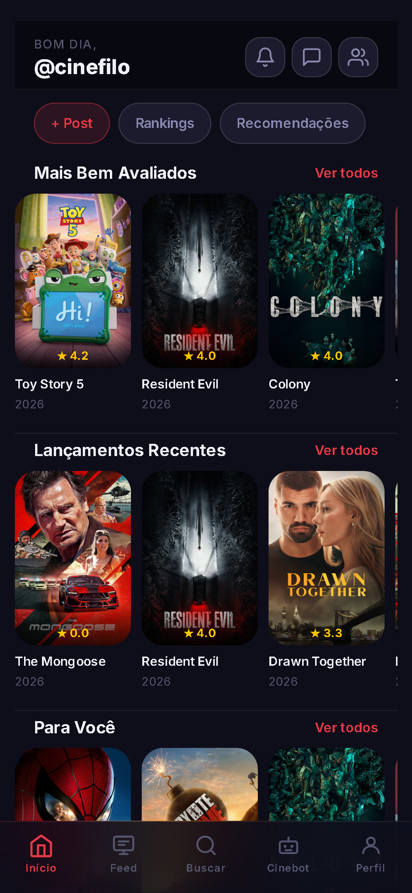
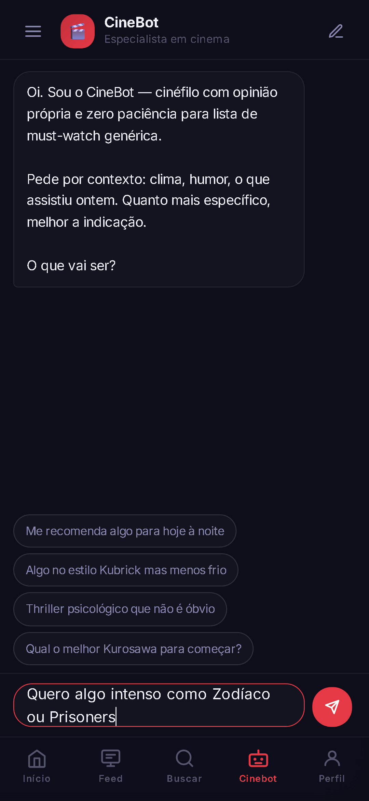
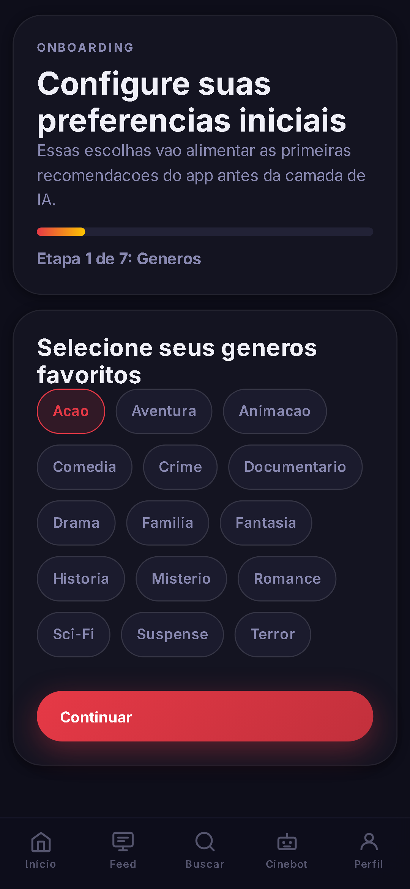
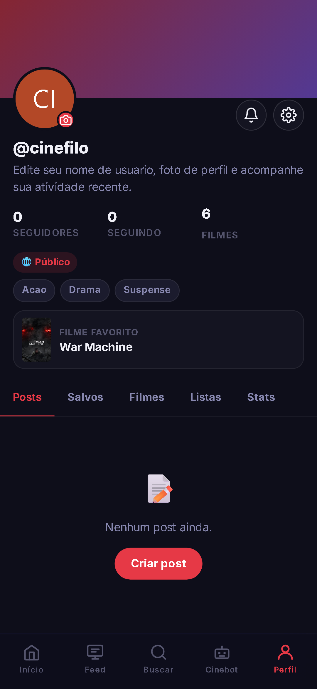

# Moviz — App

App do **Moviz — Diário de Filmes**, uma rede social mobile-first para cinéfilos: avalie filmes,
acompanhe o que seus amigos estão vendo e descubra o que assistir a seguir com recomendações
personalizadas e um assistente de cinema com IA. Um único código React roda na web e como app
nativo **Android e iOS** via Capacitor.

> API (FastAPI): [moviz-backend](https://github.com/Ricardo2311/moviz-backend) ·
> Status: MVP completo, em preparação para lançamento na Google Play e App Store.

**Stack:** React 19 · React Router 6 · Capacitor 8 (Android/iOS) · CSS puro · AdMob ·
RevenueCat · Firebase Cloud Messaging · Sentry (opcional)

<p align="center">
  
  
  
  
</p>

---

## Funcionalidades

- **Descoberta:** Home com linhas de filmes (mais bem avaliados, lançamentos, "Para você"),
  busca de filmes, pessoas, clubes e listas, detalhes do filme com "onde assistir".
- **Diário:** avaliações de até 5 estrelas, "já assisti", favoritos, histórico e estatísticas.
- **Social:** feed (descobrir / seguindo), posts com review e alerta de spoiler, curtidas,
  comentários, **#hashtags** e **@menções** com autocomplete, seguir pessoas, contas privadas.
- **Listas, clubes e Direct:** listas com reordenação, clubes com papéis e moderação,
  mensagens individuais e em grupo.
- **CineBot:** chat com um assistente cinéfilo com IA, com histórico de conversas e cards de
  filmes clicáveis.
- **Premium e anúncios:** paywall com planos da loja e restauração de compras; anúncio
  recompensado que libera mensagens extras no CineBot.
- **Onboarding** em etapas, recuperação de senha, exclusão de conta e páginas de Privacidade
  e Termos exigidas pelas lojas.

## Decisões técnicas

- **Uma base, três plataformas:** React compilado e empacotado pelo Capacitor. Integrações
  nativas (botão voltar do Android, deep links, status bar, teclado, haptics, share, push,
  anúncios e compras) ficam isoladas em handlers e módulos próprios.
- **Sem gerenciador de estado global:** estado local por página e um **cache SWR em memória**
  (`src/apiCache.js`) que mostra o dado anterior na hora e revalida em segundo plano —
  navegação instantânea sem adicionar Redux.
- **Code splitting:** todas as telas autenticadas são carregadas sob demanda (`React.lazy`).
- **Camada de API única** (`src/api.js`): uma função por endpoint, com tratamento de erro
  padronizado (`err.status`, `err.code`) e mensagens do servidor já em pt-BR.
- **CSS puro mobile-first:** tema escuro com design tokens em `:root`, respeitando as áreas
  seguras (`env(safe-area-inset-*)`) de notch e barra de gestos.
- **Monetização segura:** o app nunca decide sozinho se o usuário ganhou uma recompensa ou é
  Premium — o backend confirma com o Google (AdMob SSV) e com o RevenueCat.
- **Resiliência:** `ErrorBoundary` (com Sentry opcional), aviso de modo offline e
  pull-to-refresh.
- **Feature flags** simples em `src/features.js`.

## Estrutura

```
src/
├── App.js            # rotas, ErrorBoundary, handlers nativos (voltar, deep link, offline)
├── api.js            # todas as chamadas HTTP
├── apiCache.js       # cache stale-while-revalidate em memória
├── monetization.js   # AdMob (anúncio recompensado) e RevenueCat (assinatura)
├── features.js       # feature flags
├── pages/            # uma tela por rota (~30)
├── components/       # layout, navegação, modal de filme, perfil, rich text
└── hooks/            # pull-to-refresh, push notifications
android/ ios/         # projetos nativos gerados pelo Capacitor
```

## Rodando localmente

Pré-requisitos: Node.js 20+ e o [backend](https://github.com/Ricardo2311/moviz-backend)
rodando em `http://localhost:8000`.

```bash
npm install
npm start          # http://localhost:3000
```

O endereço da API vem de `REACT_APP_API_URL`: `.env.development.local` para desenvolvimento
e `.env.production` para o build. Todas as variáveis `REACT_APP_*` são embutidas no app —
por isso só contêm valores públicos (endereço da API, IDs de anúncio, chaves públicas de SDK).

### App nativo

```bash
npm run build
npx cap sync
npx cap open android   # ou: npx cap open ios (requer macOS + Xcode)
```

---

Desenvolvido por **Ricardo Gebara** ([@Ricardo2311](https://github.com/Ricardo2311)).
Código publicado para fins de portfólio — todos os direitos reservados.
